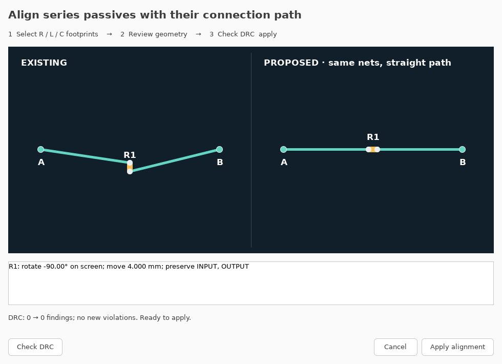
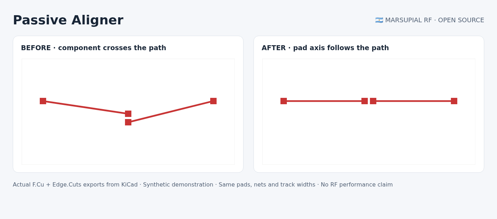

# 🇦🇷 Passive Aligner for KiCad 🇦🇷

**Rotate and reposition a series resistor, capacitor, or inductor so its pad axis follows the local connection path.** The plugin straightens its existing track chains, preserves pad identities, nets, layers and widths, and checks the proposed change with KiCad DRC before applying it.

Built by [Marsupial RF](https://marsupialrf.com) in Argentina. MIT licensed. No AI service, account, network connection, OpenEMS, or external Python package is needed. KiCad's Python, wxPython and `kicad-cli` are required. Tested on **KiCad 10.0.7 / Linux**; other versions and operating systems are not yet qualified.



## Use it

1. Select a routed **R, C or L footprint**, or one of its pads, in the PCB Editor. Enable **Footprints** in the selection filter if necessary.
2. Open **Tools → External Plugins → Passive Aligner**, or click its toolbar icon.
3. Review **Existing** and **Proposed**. The plugin projects the pad midpoint onto the line between its two local connection anchors and aligns the pad axis with that line. Each splitter branch gets its own anchors.
4. Press **Check DRC**. This runs KiCad on isolated before/after copies, with the saved project settings and custom rules. New DRC findings block **Apply alignment**.
5. Press **Apply alignment**. Review the board, then save it yourself. The plugin does not save over your board. It also stores a snapshot under `.passive-aligner-backups/` beside the board, including existing project/rule files. KiCad's ActionPlugin runner manages the normal undo transaction; the on-disk backup is independent of undo.

The preview is a connection diagram, not a copper or field rendering. The generic example below is exported from the actual before/after KiCad boards. It illustrates geometry, not measured RF performance.



## Install

Download the release ZIP and extract the **`passive_aligner`** directory into a user scripting-plugin directory shown by KiCad's **Preferences → PCB Editor → Action Plugins → Open Plugin Directory**. Alternatively, copy that directory from this repository. Refresh plugins or reopen the PCB Editor after saving your work. Do not install a second nested `passive_aligner/passive_aligner` directory.

Ensure that a **matching version** of `kicad-cli` is on the environment PATH used to launch KiCad. For bundled or nonstandard installations, set `PASSIVE_ALIGNER_KICAD_CLI` to its executable path before launching KiCad. No installation-specific paths are embedded in the plugin.

## Agent / command-line use

The same geometry and DRC code is available without controlling the GUI. Use a Python interpreter able to `import pcbnew` from your KiCad installation:

```bash
# Inspect the plan; input stays untouched.
python align.py board.kicad_pcb --reference R1

# Apply only after DRC passes, to a NEW output file.
python align.py board.kicad_pcb --reference R1 --output aligned.kicad_pcb

# Optional explicit executable; references can be repeated for independent paths.
python align.py board.kicad_pcb --reference R1 --reference C2 \
  --kicad-cli /path/to/kicad-cli --output aligned.kicad_pcb
```

Output is JSON. Exit 0 means the requested operation succeeded, 1 means invalid input or an execution failure, and 2 means DRC rejected a proposed change. A plan-only command can succeed with no changes; inspect `changes` and `skipped`. Existing output boards and sidecars are never overwritten. An agent or MCP executor can invoke this CLI; it is not itself an MCP server.

## Scope

- Exactly two numbered SMD pads, on one outer copper layer, with distinct assigned nets. Bottom-side components are supported.
- Existing, unlocked straight-track chains must terminate at pad centres. Each chain keeps a constant width and layer. The next external pad, via, or explicit endpoint junction is its anchor. Pad/net associations are never swapped to choose a shorter angle.
- Ambiguous connections, interior branches, arcs, width transitions, ground-connected shunts, pads touching filled zones, and locked items are skipped. Multiple selected components sharing a connection must be handled separately. Unrouted footprints have no reliable anchors and are skipped.
- No obstacle shoving: a new short, clearance error, courtyard collision, or other new DRC signature blocks the correction. Existing findings remain visible and are not certified away. Save project/rule changes before checking. KiCad's configured ignored checks remain ignored; the plugin does not replace your rules.
- Straightening changes electrical length. It does **not** preserve matched delay, tune impedance, certify RF performance, or replace electromagnetic simulation. Do not apply it to tuned filters or matched-length networks without reviewing those constraints.

## Reproduce the checks

```bash
python tests/test_alignment.py
python tests/test_plugin_flow.py
python tests/make_demo.py
```

The 11 geometry/DRC tests cover rotated layouts, reversed pad numbers, bottom copper, locked/shunt/ambiguous cases, unchanged net identity, explicit branch anchors, and a real DRC rejection of a new obstacle collision. The separate GUI test exercises the modal Check DRC → Apply workflow and backup without overwriting the original. `make_demo.py` generates the public synthetic boards and captures the actual plugin dialog; the GUI scripts need a display (Xvfb works for CI). The board exports use KiCad CLI; no company board is included.

KiCad's save/connectivity helpers can propagate net assignments across touching copper. Validation uses the direct board serializer and additionally compares pad/track net identities after the CLI check, so a reassigned net cannot conceal a newly introduced short. Python embedders that import the package outside KiCad must set `PASSIVE_ALIGNER_HEADLESS=1`; the provided CLI and tests do this themselves.

Contributions and issue reports are welcome. Include the KiCad version and a minimal board you are allowed to share. This is an initial geometry tool, not a general autorouter.
